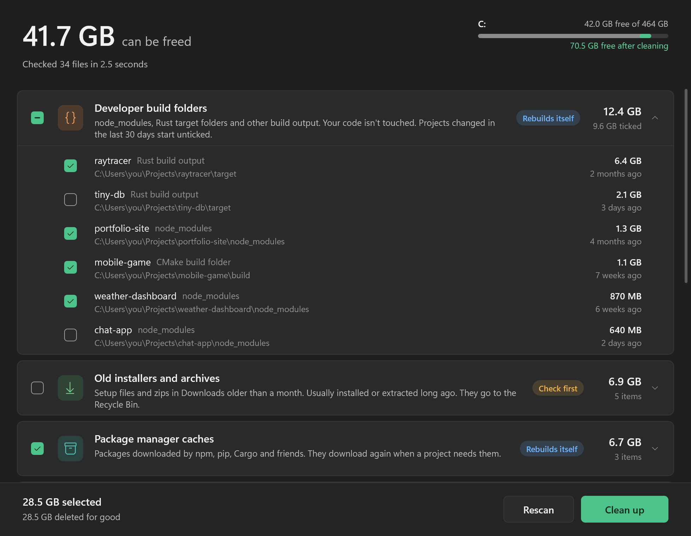

<p align="center">
  
</p>

<h1 align="center">Roomy</h1>

<p align="center">
  A disk cleaner for Windows that tells you <b>what is actually safe to delete</b>, and why.<br>
  One 540 KB exe. No installer, no account, no telemetry, no "1,284 problems found!"
</p>

<p align="center">
  
</p>

## Why

Tools like WizTree are great at showing you what is *big*. They can't tell you whether it's safe to delete.
Disk Cleanup is safe, but it doesn't know about `node_modules`, Rust `target` folders, the Discord
cache or the 6 GB Ubuntu ISO you downloaded last spring.

Roomy looks in the places where junk actually piles up, puts a label on everything it finds, and
explains the label in plain words:

| Label | Meaning |
|---|---|
| **Safe** | Nobody will miss it. Temp files older than a day, crash dumps, old Windows Update downloads. |
| **Rebuilds itself** | Apps and tools recreate it on their own. The first launch or build afterwards is a bit slower. |
| **Check first** | Probably junk, but only you can tell. Never ticked by default, and it goes to the Recycle Bin. |

## What it finds

- **Developer build folders**: `node_modules`, Rust `target`, .NET `bin`/`obj`, Gradle, Maven, CMake build
  folders, Next.js, Nuxt, SvelteKit, Turborepo, Parcel, Angular, Zig, Flutter, Elixir, Haskell, Swift, Godot,
  and any folder carrying a [`CACHEDIR.TAG`](https://bford.info/cachedir/). Each one shows the project it belongs
  to and when it was last built. Projects you touched in the last 30 days start unticked.
- **Package manager caches**: npm, Yarn, pip, uv, Cargo, Go, NuGet, Gradle, Maven, Bun, Electron, node-gyp, Scoop.
- **App caches**: any Electron or CEF app is detected automatically (Discord, VS Code, Slack, Obsidian, Notion,
  Cursor and the dozens you forgot you installed), plus Spotify, Steam, Epic and Teams.
- **Browser caches**: Chrome, Edge, Brave, Vivaldi, Opera, Firefox, Zen, LibreWolf, Waterfox, Floorp. Every
  profile. Only caches; history, passwords, cookies and bookmarks are never touched.
- **Old installers and archives**: `.exe`, `.msi`, `.zip`, `.iso` and friends in Downloads older than a month.
- **Duplicate files**: identical copies of files over 1 MB in your personal folders, compared byte for byte
  with SHA-256. One copy of each is always kept, preferring the one that isn't in Downloads.
- **Temporary files**, **crash reports**, **shader caches** and the **Recycle Bin**.
- With admin rights: **Windows Update leftovers**, the Windows temp folder and system crash dumps.

## How it stays safe

Deleting files is the one thing a cleaner must never get wrong. These rules are enforced in code and covered by
[tests](tests/test_roomy.py):

- **Junctions and symlinks are never followed.** A link inside `node_modules` that points at your documents
  gets removed as a link. The documents stay.
- **Nothing is guessed from a folder name alone.** `node_modules` needs a `package.json` and a lockfile next
  to it. `target` needs a `Cargo.toml` and Cargo's cache tag. A `Cache` folder in AppData only counts if the
  app around it is a real Chromium profile.
- **Hands off:** dot folders like `.vscode\extensions`, Python virtualenvs, in-source CMake builds, files
  inside git repositories (for duplicates), and OneDrive files that only live in the cloud (reading those
  would download them).
- **Drive roots, Windows, Program Files and your profile folders** can never be deleted as a whole, whatever
  a bug elsewhere might ask for.
- **Files that are open** in another app are skipped and counted, never forced.
- **"Check first" items go to the Recycle Bin**, so a wrong call is one click to undo.
- Before anything happens you see exactly how much is deleted for good and how much goes to the Recycle Bin.

## Download

Grab `roomy.exe` from [Releases](../../releases) and run it. Windows 10 and 11, 64-bit.

Roomy runs as a normal user. Click **Include Windows system files** to restart it as administrator and
also check Windows Update leftovers and system crash dumps.

## Command line

```
roomy --scan                 list what can be cleaned
roomy --scan --json          the same, as JSON
roomy --clean --yes          remove everything that is ticked by default
roomy --clean --yes --all    remove every item found
```

`--no-duplicates` skips the slowest check, `--no-recycle` deletes for good instead of using the Recycle Bin,
and `--home <folder>` pretends a folder is your whole PC, which is how the tests run.

## Building

Needs Visual Studio 2022 or later with the C++ workload, plus CMake and Ninja.

```
build.bat
python tests/test_roomy.py
```

`build.bat` finds Visual Studio on its own and produces a single static `build\roomy.exe`. MinGW-w64 works
too: `cmake -S . -B build -G Ninja && cmake --build build`.

The UI is plain Win32 with Direct2D and DirectWrite. No frameworks, no web view. It follows your light or
dark mode setting and is sharp at any DPI.

| File | What it does |
|---|---|
| `src/scan.cpp` | Every check, and the rules for what counts as junk |
| `src/clean.cpp` | Deleting, the Recycle Bin and the protected folder list |
| `src/fs.cpp` | Long paths, link-safe walking and deleting, parallel folder walks |
| `src/ui.cpp` | The window |
| `src/cli.cpp` | `--scan` and `--clean` |
| `tests/test_roomy.py` | Builds a fake PC full of traps and checks every rule above |
| `tools/demo.py` | The fake PC used for the screenshots |

## License

MIT
